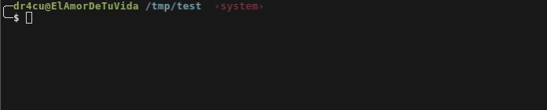

# CP Command Rewrite

[](https://opensource.org/licenses/MIT)
[](#)
[](#)

Este proyecto se centra en reescribir el comando **cp** de linux añadiendole mejora tanto visuales como internas.

---

## Tabla de Contenidos

- [Demostración](#-demostración)
- [Características principales](#-características-principales)
- [Tecnologías utilizadas](#-tecnologías-utilizadas)
- [Instalación y Configuración](#-instalación-y-configuración)
- [Uso](#-uso)
- [Hoja de Ruta (Roadmap)](#-hoja-de-ruta-roadmap)
- [Contribución](#-contribución)
- [Licencia](#-licencia)

---

## 📸 Demostración



## Características principales

- **Rápido y liviano:** Diseñado con un enfoque en el rendimiento.
- **Fácil de modular:** Estructura limpia y fácil de extender.

---

## Cómo lo hice?

Use C puro, usando librerias que viene en cualquier instalación comun de un entorno de C.

## Instalación y Configuración

### Prerrequisitos

Asegúrate de tener instalado lo siguiente:

* `base-devel` (en cualquiera de su versiones)

### Pasos de instalación

1. **Clonar el repositorio:**
   
   ```bash
   git clone https://github.com/DraculaSlayer/my_cp.git
   cd my_cp
   make
   sudo make install
   ```
